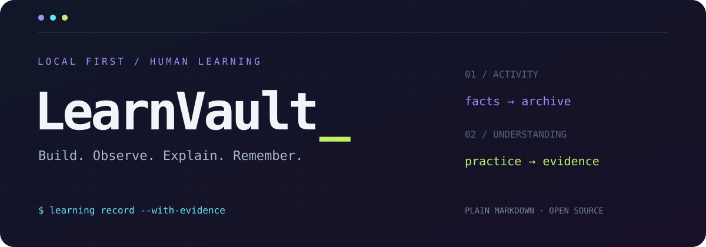
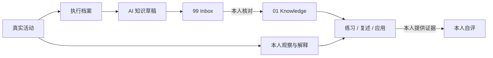
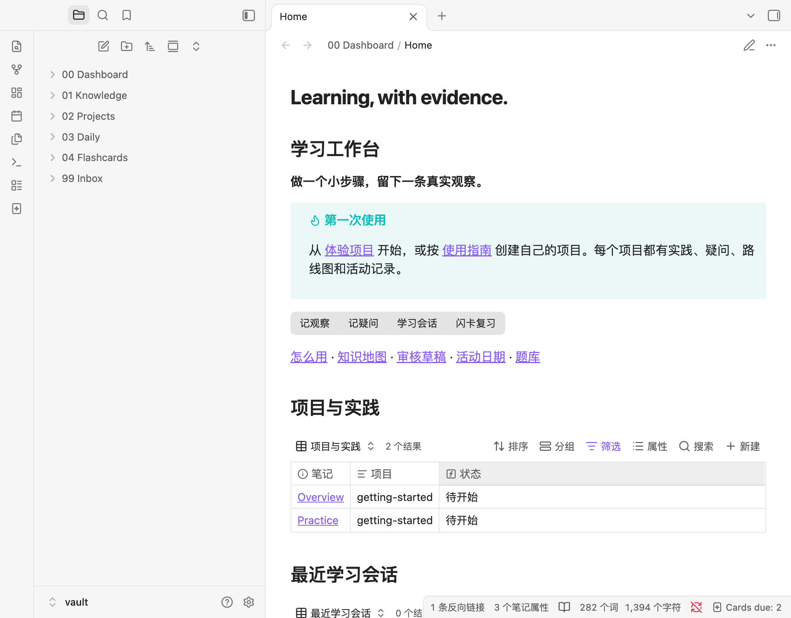

<div align="center">



# LearnVault

### 把做过的事，变成有证据的学习。

**A local-first Obsidian workflow for humans learning with AI.**

[](LICENSE)


[快速开始](#quick-start) · [怎么工作](#the-loop) · [接入 AI](#bring-your-agent) · [工作台](obsidian/README.md) · [贡献](CONTRIBUTING.md)

</div>

---

你和 AI 一起写完了一段代码，读完一篇论文，或者解出了一道题。

结果留在了文件里。过程散在终端和对话里。至于自己究竟理解了多少，需要另一份证据。

LearnVault 把这几件事接起来：**实际活动有档案，知识有来源，疑问有去处，理解有练习。**

它是一套可以复制、改造、带走的 Obsidian 工作流。你可以用它学编程、数学、语言、设计，做课程项目，或者组织研究阅读。领域由你定义。

## The principle

> **AI 可以推进任务。理解，需要你自己的证据。**
>
> `execution ≠ understanding`

- **执行档案**：谁做了什么、实际检查结果、发现、卡点与下一步。
- **学习会话**：本人提供的观察、解释与问题。
- **知识草稿**：AI 可提炼到 Inbox；本人核对后才进入知识库。
- **掌握程度**：本人根据复述、练习和应用自评，审核也不会自动升级它。

没有每日打卡任务。没有凭笔记数量算出的掌握率。今天没做这件事，就不生成今天的活动。

## Quick start

需要 **Python 3.10+**；浏览笔记需要 Obsidian。Python 工具只用标准库，不需要 API Key。

### 1 · 打开工作台

下载仓库或克隆：

```sh
git clone https://github.com/YangChen-cn/obsidian-learning-workflow.git
cd obsidian-learning-workflow
```

在 Obsidian 中选择 **打开本地仓库**，打开其中的 `vault/`，进入 `00 Dashboard/Home`。

Markdown 正文可直接阅读。按钮是可选增强，安装步骤见下方。

### 2 · 创建自己的主题

在仓库根目录运行：

```sh
python3 scripts/learning.py project linear-algebra --title "线性代数"
python3 scripts/learning.py project english --title "英语表达"
```

每个项目会生成概览、分阶段实践、路线图、疑问和两类会话目录。多个项目共用一个知识库，知识领域可以自由增加。

`getting-started` 是一个空白体验项目：没有个人记录，也没有预填的学习成果。

### 3 · 做一次真实记录

做完一个步骤，先在项目的 `Practice` 页面留三样东西：**关键证据、自己的解释、可选的疑问**。一段输出或口语化说明就够。

让 AI 根据 [AGENTS.md](AGENTS.md) 记录它实际执行的工作，或者手动准备会话 JSON：

```sh
# macOS / Linux；Windows 可用文件管理器复制同一个示例。
mkdir -p .learning
cp docs/session.example.json .learning/session.json
# 编辑 JSON，替换占位内容和 project，再运行：
python3 scripts/learning.py record .learning/session.json
python3 scripts/learning.py validate
```

命令只归档你明确提供的事实，不会运行 JSON 里的检查命令。`not_run`、`failed`、`passed` 分别保留。

### 4 · 按需启用按钮

先打开一次新 vault，再**关闭 Obsidian**，防止插件覆盖刚写入的配置：

```sh
python3 scripts/obsidian_setup.py install
python3 scripts/obsidian_setup.py apply
python3 scripts/obsidian_setup.py --skip-app-check check --require-content
```

重新打开 vault，在提示中信任并启用社区插件，然后从首页点击 **记观察 / 记疑问 / 学习会话 / 闪卡复习**。

插件固定版本并校验 SHA-256。安装保留已有复习数据；配置只合并托管项，修改前备份。新增项目后重新运行 `apply`，再重启或重载 QuickAdd。

## The loop



一次记录应当让下次的你知道：做到哪里、证据在哪里、还有什么不确定，以及接下来可以验证什么。

## Inside Obsidian



## Your vault, your subjects

```text
vault/
├── 00 Dashboard/        首页、Bases 视图、使用指南、模板
├── 01 Knowledge/        已审核知识；按自己的领域组织
├── 02 Projects/         任意数量的学习项目
│   └── <project>/
│       ├── Overview.md  目标与入口
│       ├── Practice.md  分阶段实践与本人记录
│       ├── Questions.md 疑问
│       ├── Roadmap.md   路线图
│       ├── Progress.md  自动活动索引
│       ├── Sessions/    实际执行档案，含 Agent 工作
│       └── Learning/    本人主动记录的学习会话
├── 03 Daily/            仅有活动的日期索引
├── 04 Flashcards/       Markdown 自测题库
└── 99 Inbox/            AI 候选与待审核草稿
```

这是 Markdown 里的学习系统：文件是真实数据，Bases 提供视图，按钮负责写回文件。关闭插件后，正文和记录仍然属于你。

## Bring your agent

把 [AGENTS.md](AGENTS.md) 交给你使用的 Agent，让它能读写这个目录并执行 Python 即可。适用于支持文件工具的 AI；没有文件工具时，让 AI 输出 JSON，由你保存并执行归档。

每次结束任务时可以这样说：

> 结束本次工作并按 AGENTS.md 归档。项目是 linear-algebra。记录实际执行者、变化、检查命令与结果、未解问题和下一步；有新增价值的知识另写 Inbox 草稿。我的观察只能来自我实际提供的内容，保留我的掌握状态。

脚本本身不调用模型，不后台读取聊天历史，也不安排定时整理。Agent 根据当前任务和明确提供的材料执行归档。Local REST API / MCP 是可选接口，不是依赖。

更详细的交接方式见 [AI 接入指南](docs/agent-integration.md)。

## Small commands. Clear boundaries.

| 操作 | 命令 |
| --- | --- |
| 创建主题 | `python3 scripts/learning.py project <id> --title "名称"` |
| 归档实际工作 | `python3 scripts/learning.py record .learning/session.json` |
| 更新索引与项目菜单 | `python3 scripts/learning.py refresh` |
| 本人明确审核草稿后归档 | `python3 scripts/learning.py review '99 Inbox/笔记.md' --approve` |
| 检查笔记属性与链接 | `python3 scripts/learning.py validate` |
| 运行自动化测试 | `python3 -m unittest discover -s tests` |

有 Make 时可以使用 `make check`、`make learn-refresh` 等快捷入口。Windows 无须安装 Make，直接用 Python 命令即可。

`workflow.json` 配置 vault 相对路径与 IANA 时区，默认 `UTC`。例如将 timezone 改为 `Asia/Shanghai`；已归档日期不会被重写。Windows 若缺少 IANA 时区数据库，可先运行 `python -m pip install tzdata`。

## Built to stay yours

- 私人会话、原项目代码、个人学习笔记、旧 Git 历史均未包含在这个开源模板中。
- `.obsidian/`、`.learning/`、复习历史、日志与凭据保持本地。发布自己使用后的副本前，还应核对你新写入的正文和附件。
- 按稳定 ID 去重；相同输入重试不新增，冲突内容保留原记录并报错。
- 归档按实际活动触发，检查有实际结果才标通过，个人自评由本人决定。
- 不自动 Git 提交或推送。你选择何时发布笔记，以及公开哪些内容。

## Scope & roadmap

第一版聚焦 **主题创建 → 事实归档 → 活动索引 → 知识审核 → 自测**。阅读、课程或研究材料可通过来源链接与摘要加入会话；没有自动抓取阅读器、课程平台或任意聊天记录的功能。

欢迎围绕实际使用提出 Issue：更多主题模板、显式来源导入、可选 Git 证据适配器和更好的无插件体验。贡献约定见 [CONTRIBUTING.md](CONTRIBUTING.md)。

## License

项目代码、配置、原创文档和图形按 **GPL-3.0-only** 发布，完整文本见 [LICENSE](LICENSE)。下载的 Obsidian、第三方插件和依赖保留各自许可，未捆绑在仓库中。来源说明见 [THIRD_PARTY.md](THIRD_PARTY.md)。

<div align="center">

**Build. Observe. Explain. Remember.**

</div>
